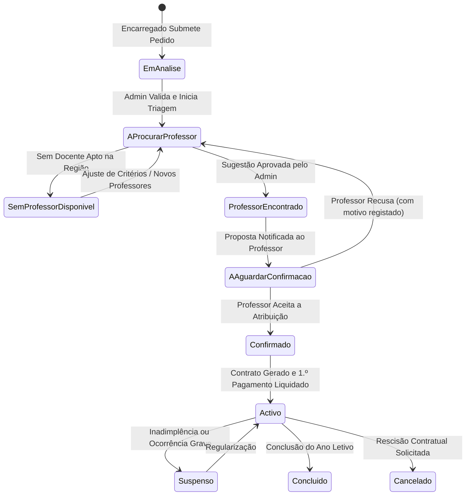

# 03 — CICLO OPERACIONAL: PEDIDOS E MATCHING

> **Documento Guia TM-Educa**  
> **Âmbito:** Formulário de pedido, máquina de estados, histórico de auditoria e algoritmo de matching

---

## 1. Submissão do Pedido de Acompanhamento

O fluxo operacional tem início quando o Encarregado de Educação submete uma solicitação de acompanhamento escolar no `/portal-encarregado/solicitar-acompanhamento`.

### Campos Obrigatórios do Pedido:
* **Aluno:** Seleção do aluno previamente registado na sua conta tutelar.
* **Ano Escolar e Sistema de Ensino:** Herdado do aluno ou selecionado no ato.
* **Disciplina:** Escolhida do catálogo de disciplinas ativas da TM-Educa.
* **Duração da Aula:** 1 hora (60 min), 1h30 (90 min) ou 2 horas (120 min).
* **Frequência Semanal:** 2, 3 ou 4 dias por semana.
* **Dias e Horários Preferenciais:** Seleção dos dias e faixas horárias convenientes para a família.
* **Modalidade:**
  * `Domicilio` (deslocação do professor à residência do aluno).
  * `Online` (aulas virtuais assistidas).
  * `Centro` (aulas presenciais no centro educativo físico **Temilara**).
* **Localização (se Domicílio):** Município, bairro, morada detalhada e pontos de referência.
* **Objetivo Pedagógico:**
  * Acompanhamento contínuo
  * Melhoria de notas
  * Preparação para testes
  * Preparação para exames nacionais / admissão
  * Recuperação de matéria em atraso
  * Outro
* **Observações Livres:** Recomendações particulares para o professor.

---

## 2. Máquina de Estados do Pedido

O ciclo de vida de um pedido obedece a uma máquina de estados estrita:

### Regra de Auditoria de Estados (`HistoricoEstadoPedido`):
Toda e qualquer transição entre estados cria obrigatoriamente um registo na base de dados com:
* `pedido_id`
* `estado_anterior` e `novo_estado`
* `alterado_por_utilizador_id`
* `motivo` / justificação textual
* `data_hora`

---

## 3. Algoritmo de Matching (Assistente de Decisão do Admin)

No MVP, o sistema não atribui o aluno de forma cega ou puramente automática. Em vez disso, gera uma **classificação de compatibilidade** que assiste o administrador na escolha ideal:

### 3.1. Filtros Eliminatórios (Critérios Obrigatórios)
Um professor é de imediato descartado da lista se falhar em qualquer um destes critérios:
1. **Disciplina e Nível:** O professor não tem competência registada na disciplina e ano escolar do aluno.
2. **Modalidade:** O professor não leciona na modalidade pedida (ex.: pedido presencial ao domicílio, mas o professor só leciona online ou no Centro Temilara).
3. **Zona Geográfica:** Se for ao domicílio, o município/bairro do aluno não está incluído nas zonas de atendimento do professor.
4. **Incompatibilidade Horária:** O professor já tem outra aula agendada no mesmo horário ou declarou estar indisponível nesses blocos.

### 3.2. Pontuação de Preferência (Ranking de 0 a 100 Pontos)
Para os professores aprovados nos critérios eliminatórios, calcula-se o seguinte score:

| Critério | Peso | Explicação da Regra |
| :--- | :---: | :--- |
| **Avaliação Histórica** | **30%** | Média das avaliações recebidas de encarregados anteriores (escala 1 a 5 estrelas). |
| **Proximidade Geográfica** | **25%** | Mesma zona ou bairro adjacente, facilitando a pontualidade e reduzindo atrasos de trânsito. |
| **Experiência e Formação** | **20%** | Anos de experiência docente comprovada e nível académico no ensino superior. |
| **Carga Horária Atual** | **15%** | Professores com capacidade de agenda disponível têm prioridade sobre docentes perto da sobrecarga. |
| **Histórico de Assiduidade** | **10%** | Taxa de assiduidade e ausência de faltas injustificadas nos acompanhamentos anteriores. |

### 3.3. Confirmação e Atribuição
1. O Administrador seleciona o professor melhor pontuado (ou ajusta conforme julgamento pedagógico) e envia a proposta.
2. O Professor recebe um alerta imediato no seu portal com os detalhes da proposta (disciplina, ano, bairro, horário proposto e o seu valor de remuneração).
3. Se o Professor aceitar, o pedido avança para `Confirmado`.
4. Se o Professor recusar, é obrigado a selecionar/escrever um motivo (ex.: conflito superveniente de agenda), e o pedido regressa ao estado `A procurar professor` para nova seleção pelo administrador.
