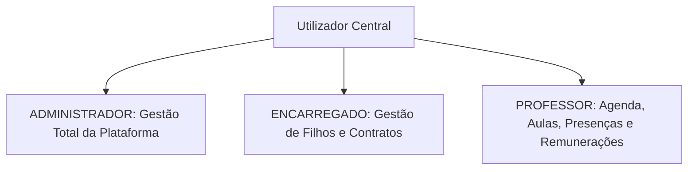

# 02 — UTILIZADORES, PERFIS E ALUNOS

> **Documento Guia TM-Educa**  
> **Âmbito:** Perfis de acesso (RBAC), estrutura tutelar de alunos e cadastro de explicadores

---

## 1. Perfis de Utilizador (Roles & RBAC)

O ecossistema inicial contempla três tipos de utilizador estritamente segregados:



### 1.1. Administrador (`ADMINISTRADOR`)
* Acesso completo ao painel `/administracao`.
* Gere utilizadores, catálogo escolar, tabela de preços e parâmetros do sistema.
* Efetua e valida correspondências (*matching*) de professores a pedidos.
* Aprova propostas, formaliza contratos e emite folhas de remuneração.
* Gere ocorrências, reclamações e mediações de conflito.

### 1.2. Pai (`ENCARREGADO`)
* Acesso ao `/portal-encarregado`.
* Pode cadastrar múltiplos alunos sob a sua responsabilidade.
* Submete novos pedidos de acompanhamento escolar.
* Acompanha o calendário de aulas dos seus filhos.
* Visualiza relatórios de presença, sumários pedagógicos e avalia os professores.
* Consulta pagamentos pendentes e anexa comprovativos bancários.

### 1.3. Professor / Explicador (`PROFESSOR`)
* Acesso ao `/portal-professor` (otimizado para dispositivos móveis).
* Define o seu perfil profissional: biografia, disciplinas que leciona, níveis, modalidades e bairros atendidos.
* Configura a sua grelha semanal de disponibilidade horária.
* Recebe propostas de novos alunos atribuídos pelo administrador (podendo aceitar ou recusar com justificação).
* Regista presenças e sumários após a conclusão de cada aula.
* Consulta extratos de aulas lecionadas e remunerações a receber.

---

## 2. Modelo Tutelar do Aluno (MVP)

> [!IMPORTANT]
> **RELAÇÃO TUTELAR NO MVP:**  
> O Aluno **não possui conta de utilizador independente** nesta fase inicial.  
> O aluno pertence à conta do Pai:
> ```text
> Pai
>   ├── Aluno 1 (ex.: 4.º Ano - Ensino Primário)
>   ├── Aluno 2 (ex.: 10.º Ano - Ciências Físicas e Biológicas)
>   └── Aluno 3 (ex.: 12.º Ano - Ciências Económicas e Jurídicas)
> ```

A arquitetura de dados e chaves estrangeiras foi concebida para permitir, no futuro, vincular opcionalmente um utilizador próprio ao aluno sem quebrar a estrutura existente.

### Campos do Cadastro do Aluno:
* Nome completo
* Data de nascimento e sexo
* Sistema de ensino (Geral Angolano, Português, Cambridge, etc.)
* Ano escolar (1.º ao 12.º ano)
* Escola / Colégio que frequenta
* Disciplinas pretendidas
* Principais dificuldades identificadas
* Objetivos pretendidos (acompanhamento contínuo, exames, recuperação)
* Observações e necessidades educativas especiais

---

## 3. Cadastro e Perfil do Professor

O perfil do explicador possui um ciclo de verificação para garantir o padrão de qualidade TM-Educa:

### Estados do Professor:
1. `Pendente`: Registo inicial efetuado; aguarda submissão de documentos.
2. `Em analise`: Documentação e competências sob triagem pela direção pedagógica.
3. `Verificado`: Documentação e entrevistas aprovadas.
4. `Activo`: Disponível para receber alunos e lecionar.
5. `Suspenso`: Bloqueado temporariamente devido a ocorrência ou falta grave.
6. `Inactivo`: Professor pausou a colaboração com a plataforma.

### Disponibilidade Horária Semanal:
O professor parametriza blocos de disponibilidade por dia de semana:
* Exemplo: Segunda-feira: 16:00 – 20:00 | Quarta-feira: 14:00 – 18:00 | Sábado: 08:00 – 13:00.
* Esta grelha alimenta diretamente o motor de sugestões de *Matching*.
